# Concurso de Materiales Educativos — UNNOBA (CED)

<div align="center">


<br/>

**Plataforma Web integral para la gestión, evaluación, publicación y votación comunitaria de materiales educativos digitales.**  
Desarrollada para el área de **Educación Digital** de la **Universidad Nacional del Noroeste de la Provincia de Buenos Aires (UNNOBA)**.

</div>


> [!NOTE]
> **Proyecto Académico e Institucional (Desarrollado entre 2023 y 2024)**  
> Este sistema fue concebido, diseñado e implementado entre los años **2023 y 2024** como proyecto integrador para la aprobación de tres asignaturas de las carreras de Analista de Sistemas, Licenciatura en Sistemas e Ingeniería Informática en la **Universidad Nacional del Noroeste de la Provincia de Buenos Aires (UNNOBA)**: *Programación Orientada a Objetos*, *Análisis y Diseño de Sistemas II* y *Práctica Profesional y Legislación*.  
> *Este repositorio corresponde a una versión pública demostrativa (Showcase) adaptada para exhibición en portfolio profesional.*

---


## Contexto, Propósito y Motivación

Este proyecto fue concebido y desarrollado de forma colaborativa en equipo entre los años **2023 y 2024** en el ámbito académico de la **UNNOBA**, como trabajo integrador para la aprobación de tres asignaturas clave de la carrera, articulando e integrando de manera práctica sus conocimientos, metodologías y requerimientos:
- **Programación Orientada a Objetos**: Modelado de entidades del dominio en Java 21, principios SOLID, diseño desacoplado, encapsulamiento y modularidad en la lógica de negocio.
- **Análisis y Diseño de Sistemas II**: Relevamiento y especificación de requerimientos, diseño arquitectónico multicapa (MVC, Service Layer, Repository), diagramas estructurales/comportamentales y aseguramiento de la trazabilidad en el ciclo de vida del software.
- **Práctica Profesional y Legislación**: Implementación orientada a una necesidad institucional real (área de Educación Digital), gestión de requerimientos de usuarios, políticas de privacidad y protección de datos, y tratamiento adecuado de la autoría y propiedad intelectual en la publicación y difusión de materiales educativos digitales.

### La Problemática y el Objetivo

El área de **Educación Digital** de la UNNOBA realiza certámenes institucionales periódicos para incentivar la creación de recursos didácticos de calidad entre docentes y creadores de contenido educativo. Históricamente, estos concursos involucraban procesos manuales para la recepción de archivos, distribución de materiales a evaluadores, recopilación de dictámenes y votación comunitaria.

**Objetivo de la solución:**  
Digitalizar y automatizar por completo el certamen en una plataforma web unificada que proporciona:
1. **Transparencia y trazabilidad** en cada etapa: apertura de postulaciones, revisión administrativa, dictamen de jurados académicos y apertura de votación pública.
2. **Distribución equitativa y evaluación estructurada** para el cuerpo de evaluadores.
3. **Catálogo interactivo abierto a la comunidad** para la difusión y consulta de los recursos educativos ganadores y participantes de cada edición.
4. **Votación popular anónima y protegida** para incentivar el reconocimiento y la participación comunitaria.

---

## Módulos y Funcionalidades por Rol

La plataforma implementa un estricto esquema de **Control de Acceso Basado en Roles (RBAC)** mediante **Spring Security**:

```
+---------------------------------------------------------------------------------+
|                                SISTEMA CED                                      |
+-------------------+--------------------+--------------------+-------------------+
|   ADMINISTRADOR   |     EVALUADOR      |    CONCURSANTE     |   PÚBLICO GENERAL |
|   (Gestión total) | (Revisión técnica) | (Postulación R.E.) | (Voto y consulta) |
+-------------------+--------------------+--------------------+-------------------+
```

### 1. Panel de Administración (`ROLE_ADMINISTRADOR`)
- **Gestión Integral de Concursos:**
  - Apertura de nuevas ediciones con nomenclatura automática en números romanos (ej. *I Edición*, *II Edición*, etc.).
  - Configuración y ajuste flexible de hitos temporales: fecha de inicio, fin de postulaciones, periodo de evaluación, ventana de votación pública y fecha de cierre.
  - Cierre y reapertura controlada del certamen.
- **Moderación de Materiales:**
  - Bandeja de revisión previa de postulaciones: aprobación o rechazo justificado con notificación inmediata al autor.
- **Asignación a Jurados:**
  - Asignación individual de materiales a evaluadores registrados con envío automático de alertas por correo electrónico.
  - Monitoreo en tiempo real del estado de evaluación por material y por jurado.
- **Dictamen y Ganadores:**
  - Consulta detallada de rúbricas y puntajes otorgados por el comité.
  - Asignación y revocación del estado de **Material Ganador** de la edición.
- **Administración de Usuarios:**
  - Altas directas de nuevos administradores y jurados evaluadores.
  - Bajas lógicas (desactivación/reactivación) de cuentas preservando la integridad referencial histórica.

### 2. Módulo de Concursantes (`ROLE_CONCURSANTE`)
- **Registro y Autenticación:** Formulario seguro con validación de credenciales únicas y confirmación de contraseña.
- **Postulación de Materiales:** Formulario de envío de recursos pedagógicos (título, descripción detallada, autoría y carga de archivo PDF de hasta 16 MB).
- **Control de Ventana Temporal:** El sistema habilita la postulación únicamente mientras el certamen se encuentre activo y dentro del plazo estipulado.
- **Seguimiento en Vivo:** Panel personal (*Mis Materiales*) para consultar el estado del material: *Pendiente de Aprobación*, *Aprobado / Participante* o *Rechazado*.
- **Notificaciones por Correo:** Confirmación de recepción de postulación y aviso de resolución.

### 3. Módulo de Evaluadores (`ROLE_EVALUADOR`)
- **Bandeja de Pendientes:** Visualización de materiales asignados pendientes de dictamen.
- **Visor del Material:** Acceso directo a la previsualización y al documento completo del concursante.
- **Rúbrica de Calificación:** Formulario de evaluación con puntuación numérica (1 a 10) y comentarios técnicos justificativos.
- **Inmutabilidad y Control:** Control de evaluación única por jurado, impidiendo duplicidad de dictámenes y permitiendo la consulta de evaluaciones previas.

### 4. Catálogo Abierto y Votación Comunitaria (Público General / Anónimo)
- **Historial de Concursos:** Navegación por la edición actual y archivo histórico de ediciones concluidas.
- **Catálogo de Ganadores y Participantes:** Fichas de presentación de cada recurso educativo.
- **Renderizado Dinámico de Previews (PDF a PNG):** Integración con **Apache PDFBox** para generar al vuelo la miniatura de la portada del material directamente desde el servidor, sin necesidad de herramientas externas.
- **Visualización y Descarga:** Lectura del PDF embebido en el navegador (`inline`) o descarga directa (`attachment`).
- **Sistema de Votación Popular:**
  - Votación habilitada exclusivamente durante el periodo configurado por la administración.
  - **Restricción de perfil:** Exclusiva para usuarios anónimos (visitantes públicos no autenticados), evitando que jurados, concursantes o administradores alteren votos desde sus perfiles activos.
  - **Control contra Voto Duplicado:** Sistema de persistencia basado en cookies HTTP seguras (`like_{id}`) con expiración a largo plazo para asegurar un voto por visitante por material.

---

## Capturas de Pantalla y Demostración

A continuación se muestran las interfaces principales de la plataforma en funcionamiento clasificadas por rol:

### 1. Vista Pública y Catálogo Comunitario

| Portada Principal (Edición Activa) | Catálogo de Materiales Participantes |
|:---:|:---:|
| 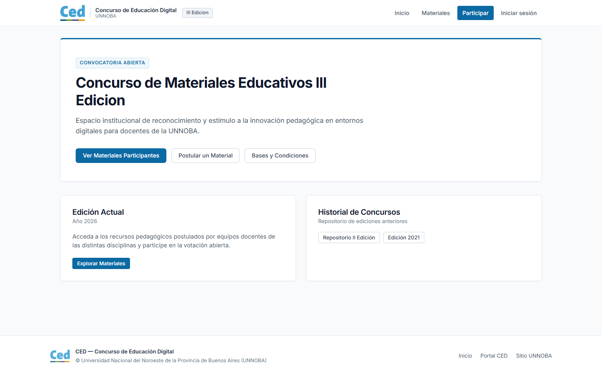 | 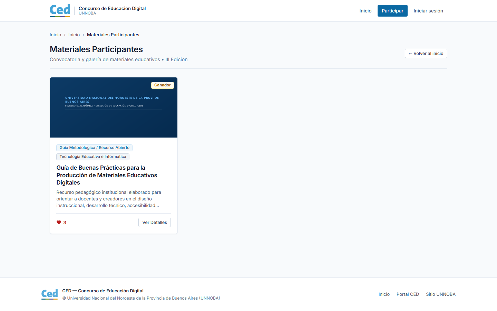 |
| *Landing page institucional con convocatoria activa y accesos rápidos.* | *Catálogo público con previsualización PDF y contador de votos.* |

### 2. 📄 Ficha Técnica del Recurso Educativo

| Vista General y Lectura de PDF | Video Institucional y Metadatos Pedagógicos |
|:---:|:---:|
| 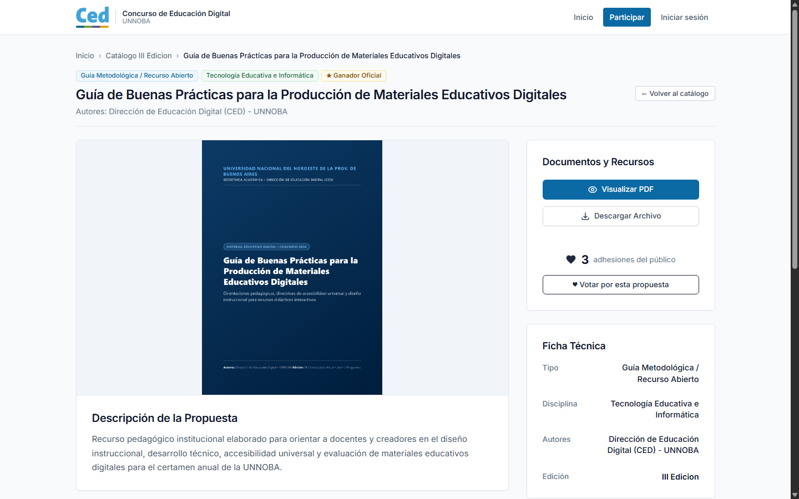 | 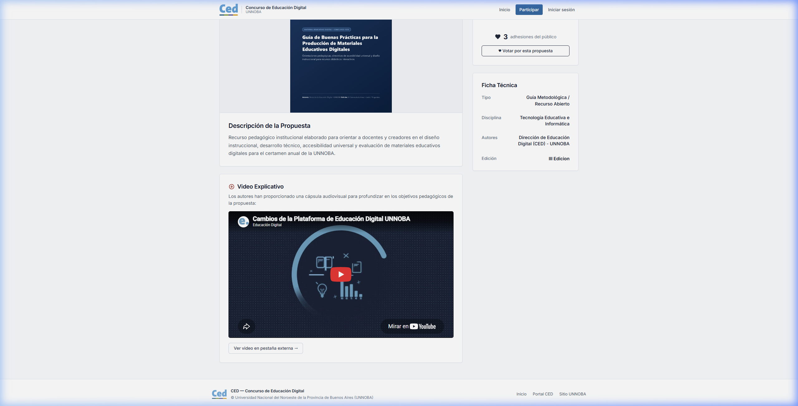 |
| *Portada del recurso educativo, autoría institucional (CED) y opciones de lectura/descarga de PDF.* | *Video explicativo oficial de Educación Digital UNNOBA integrado por iframe y rúbricas.* |

### 3. Módulo de Concursantes (`ROLE_CONCURSANTE`)

| Formulario de Postulación de Material | Panel Personal ("Mis Materiales") |
|:---:|:---:|
| 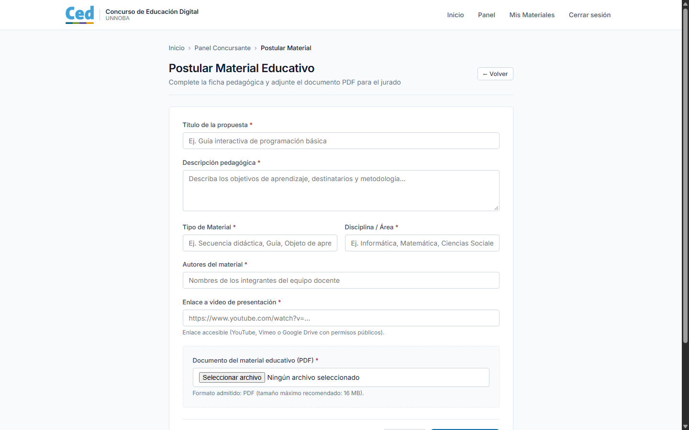 | 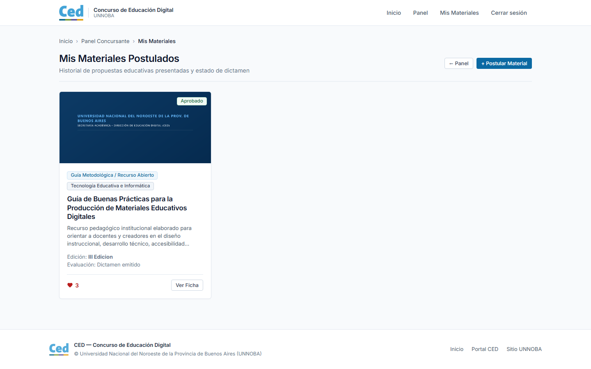 |
| *Carga de ficha pedagógica, disciplina, video y documento PDF de hasta 16 MB.* | *Seguimiento en tiempo real del estado de aprobación y dictámenes recibidos.* |

### 4. Módulo de Evaluadores (`ROLE_EVALUADOR`)

| Bandeja de Materiales Asignados | Rúbrica de Calificación y Dictamen |
|:---:|:---:|
| 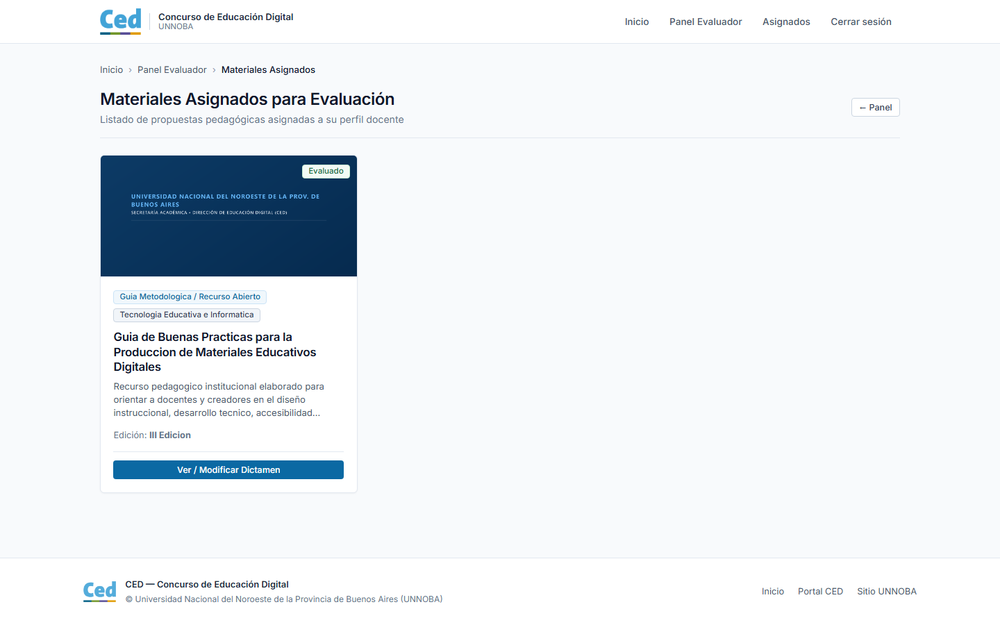 | 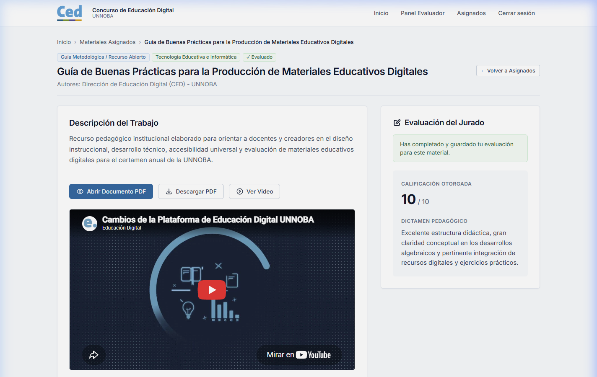 |
| *Listado de propuestas asignadas pendientes de revisión técnica.* | *Formulario de evaluación con calificación numérica (1 a 10) y comentarios técnicos.* |

### 5. Panel de Gestión y Administración (`ROLE_ADMINISTRADOR`)

| Dashboard de Control General | Cronograma de Fechas e Hitos |
|:---:|:---:|
| 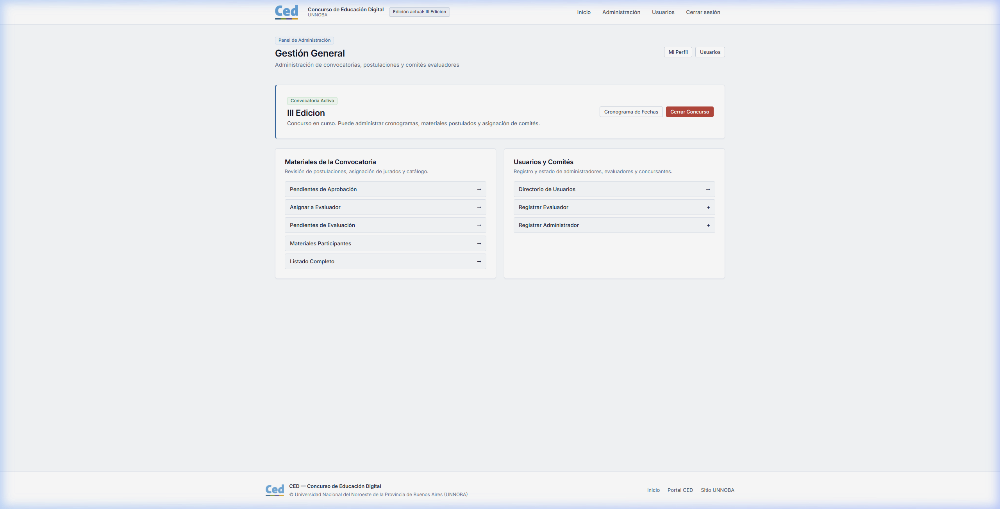 | 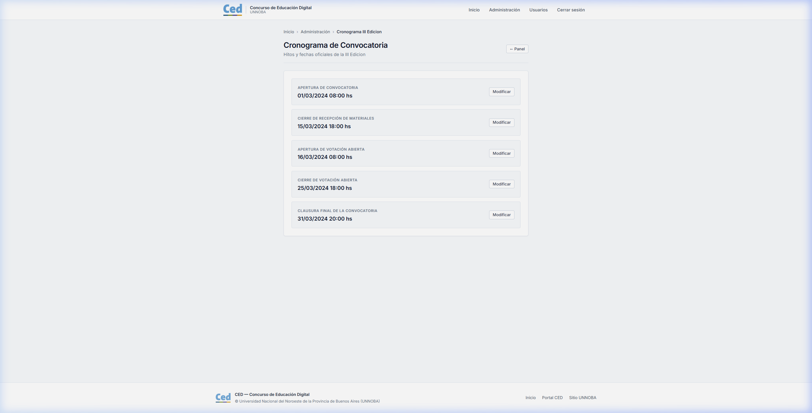 |
| *Panel integral con accesos a moderación, jurados y cierre de certamen.* | *Ajuste dinámico de ventanas temporales de postulación, evaluación y votación.* |

| Asignación de Jurados a Propuestas | Directorio y Gestión de Usuarios |
|:---:|:---:|
| 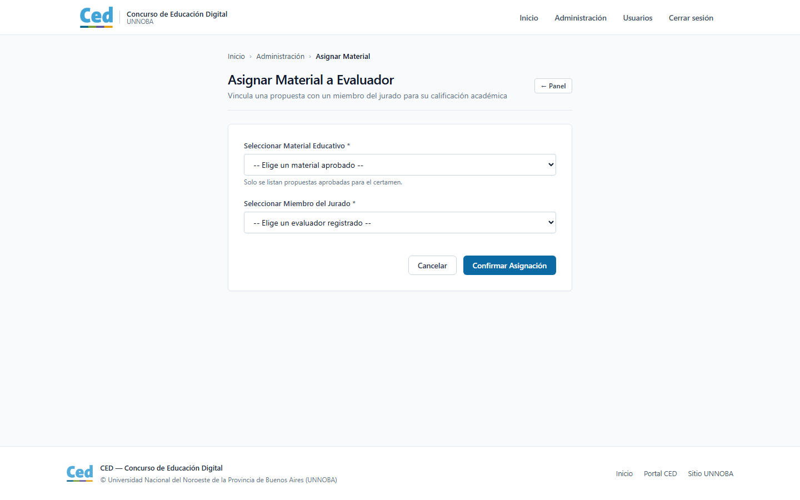 | 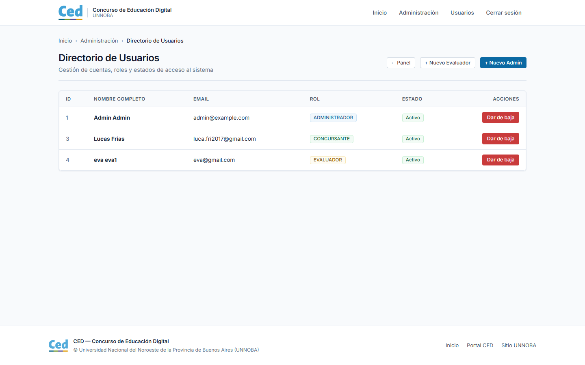 |
| *Distribución equitativa de propuestas a evaluadores según disciplina.* | *Administración centralizada con bajas y altas lógicas preservando historial.* |

| Apertura de Nueva Edición |
|:---:|
| 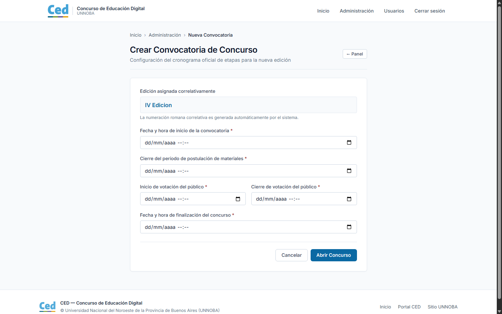 |
| *Configuración inicial con numeración romana generada automáticamente.* |

### 6. Autenticación y Registro

| Inicio de Sesión Institucional | Registro de Concursantes |
|:---:|:---:|
| 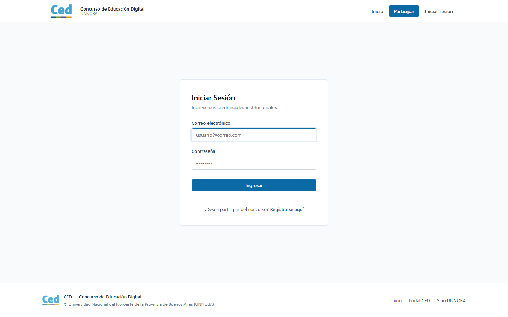 | 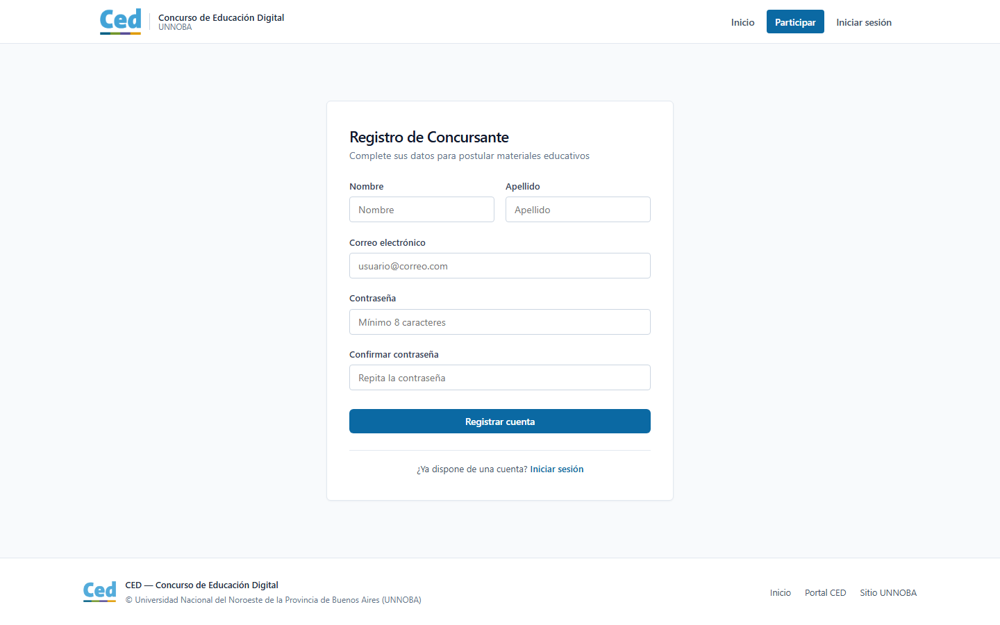 |
| *Acceso unificado con credenciales y redirección según rol (RBAC).* | *Formulario de inscripción de concursantes con validación de datos.* |

---

## Arquitectura del Sistema

El software sigue una arquitectura multicapa desacoplada y robusta fundamentada en los principios de Spring Boot y Clean Architecture:

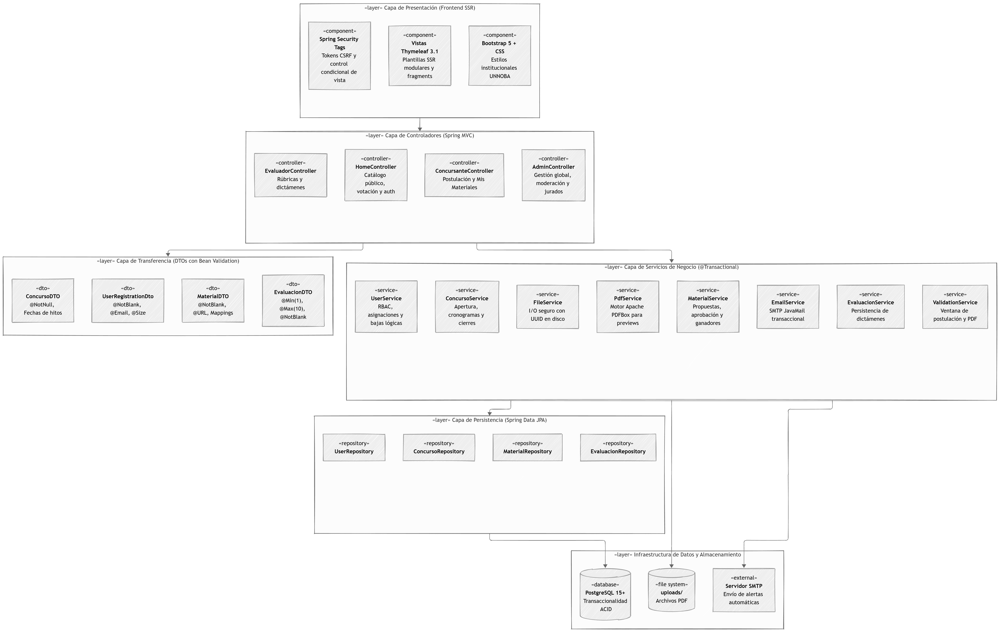

<details>
<summary>📐 Ver especificación en Mermaid.js</summary>

```mermaid
graph TD
    subgraph UI ["«layer» Capa de Presentación (Frontend SSR)"]
        Thymeleaf["«component»<br/><b>Vistas Thymeleaf 3.1</b><br/>Plantillas SSR modulares y fragments"]
        Bootstrap["«component»<br/><b>Bootstrap 5 + CSS</b><br/>Estilos institucionales UNNOBA"]
        SecurityUI["«component»<br/><b>Spring Security Tags</b><br/>Tokens CSRF y control condicional de vista"]
    end

    subgraph Controller ["«layer» Capa de Controladores (Spring MVC)"]
        HomeCtrl["«controller»<br/><b>HomeController</b><br/>Catálogo público, votación y auth"]
        ConcursanteCtrl["«controller»<br/><b>ConcursanteController</b><br/>Postulación y Mis Materiales"]
        EvaluadorCtrl["«controller»<br/><b>EvaluadorController</b><br/>Rúbricas y dictámenes"]
        AdminCtrl["«controller»<br/><b>AdminController</b><br/>Gestión global, moderación y jurados"]
    end

    subgraph DTOs ["«layer» Capa de Transferencia (DTOs con Bean Validation)"]
        UserDTO["«dto»<br/><b>UserRegistrationDto</b><br/>@NotBlank, @Email, @Size"]
        MaterialDTO["«dto»<br/><b>MaterialDTO</b><br/>@NotBlank, @URL, Mappings"]
        ConcursoDTO["«dto»<br/><b>ConcursoDTO</b><br/>@NotNull, Fechas de hitos"]
        EvaluacionDTO["«dto»<br/><b>EvaluacionDTO</b><br/>@Min(1), @Max(10), @NotBlank"]
    end

    subgraph Service ["«layer» Capa de Servicios de Negocio (@Transactional)"]
        ConcursoSrv["«service»<br/><b>ConcursoService</b><br/>Apertura, cronogramas y cierres"]
        MaterialSrv["«service»<br/><b>MaterialService</b><br/>Propuestas, aprobación y ganadores"]
        UserSrv["«service»<br/><b>UserService</b><br/>RBAC, asignaciones y bajas lógicas"]
        EvaluacionSrv["«service»<br/><b>EvaluacionService</b><br/>Persistencia de dictámenes"]
        ValidationSrv["«service»<br/><b>ValidationService</b><br/>Ventana de postulación y PDF"]
        FileSrv["«service»<br/><b>FileService</b><br/>I/O seguro con UUID en disco"]
        PdfSrv["«service»<br/><b>PdfService</b><br/>Motor Apache PDFBox para previews"]
        EmailSrv["«service»<br/><b>EmailService</b><br/>SMTP JavaMail transaccional"]
    end

    subgraph Persistence ["«layer» Capa de Persistencia (Spring Data JPA)"]
        ConcursoRepo["«repository»<br/><b>ConcursoRepository</b>"]
        MaterialRepo["«repository»<br/><b>MaterialRepository</b>"]
        UserRepo["«repository»<br/><b>UserRepository</b>"]
        EvaluacionRepo["«repository»<br/><b>EvaluacionRepository</b>"]
    end

    subgraph Storage ["«layer» Infraestructura de Datos y Almacenamiento"]
        PostgresDB[("«database»<br/><b>PostgreSQL 15+</b><br/>Transaccionalidad ACID")]
        DiskStorage[("«file system»<br/><b>uploads/</b><br/>Archivos PDF")]
        MailServer["«external»<br/><b>Servidor SMTP</b><br/>Envío de alertas automáticas"]
    end

    UI --> Controller
    Controller --> DTOs
    Controller --> Service
    Service --> Persistence
    Service --> DiskStorage
    Service --> MailServer
    Persistence --> PostgresDB
```
</details>

### Principales Decisiones de Diseño y Patrones
- **Separación de Responsabilidades (SoC):** Lógica de negocio estrictamente concentrada en servicios transaccionales (`@Service`), dejando los controladores centrados exclusivamente en validación de entrada, gestión de vistas y redirecciones contextuales (`RedirectAttributes` con mensajes Flash).
- **Desacoplamiento con DTOs y Validación Declarativa:** Todos los formularios operan mediante objetos de transferencia (`UserRegistrationDto`, `MaterialDTO`, `ConcursoDTO`, `EvaluacionDTO`) validados mediante **Bean Validation** (`jakarta.validation`), desvinculando por completo las entidades JPA del ciclo de entrada HTTP.
- **Procesamiento de Archivos e Imágenes:** Abstracción desacoplada en `FileService` (almacenamiento en disco con normalización de rutas y nombres seguros) y `PdfService` (conversión de primera página de PDF a imagen PNG en memoria mediante Apache PDFBox).
- **Persistencia y Transaccionalidad:** Uso explícito de `@Transactional` en operaciones de escritura y `@Transactional(readOnly = true)` en consultas para optimizar pools de conexiones y dirty-checking de Hibernate.
- **Diseño Defensivo:** Verificación de concurrencia y validación temporal estricta tanto en cliente como en backend para fechas de postulación, evaluación y votación.

---

## Modelo de Clases del Sistema (UML)

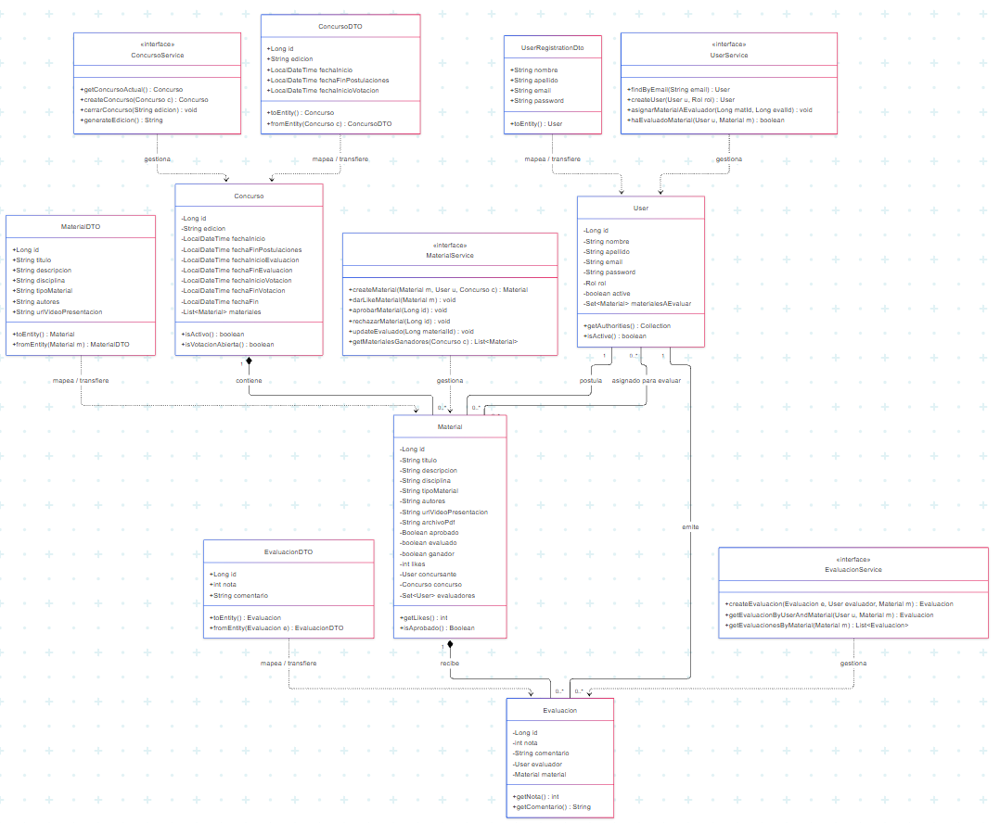

<details>
<summary>📐 Ver especificación en Mermaid.js</summary>

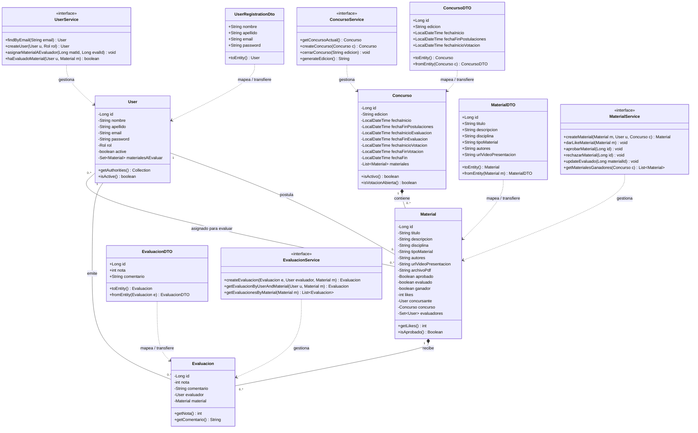
</details>

---

## Modelo de Datos y Entidades (Diagrama Relacional / DER)

El dominio relacional está optimizado para reflejar fielmente la dinámica del certamen en PostgreSQL:


<details>
<summary>📐 Ver especificación en Mermaid.js</summary>

```mermaid
erDiagram
    CONCURSO ||--o{ MATERIAL : "contiene (1..*)"
    USUARIO ||--o{ MATERIAL : "postula_como_concursante (1..*)"
    USUARIO }o--o{ MATERIAL : "asignado_evaluador (N..M)"
    MATERIAL ||--o{ EVALUACION : "recibe_dictamen (1..*)"
    USUARIO ||--o{ EVALUACION : "emite_calificacion (1..*)"

    CONCURSO {
        bigint id_concurso PK
        varchar edicion UK "Ej. III Edición"
        timestamp fecha_inicio
        timestamp fecha_fin_postulaciones
        timestamp fecha_inicio_evaluacion
        timestamp fecha_fin_evaluacion
        timestamp fecha_inicio_votacion
        timestamp fecha_fin_votacion
        timestamp fecha_fin
    }

    MATERIAL {
        bigint id_material PK
        varchar titulo
        text descripcion
        varchar disciplina
        varchar tipo_material
        varchar autores
        varchar url_video_presentacion
        varchar archivo_pdf
        boolean aprobado "NULL: Pendiente | true: Aprobado | false: Rechazado"
        boolean evaluado "true si todos los evaluadores dictaminaron"
        boolean ganador "Proclamado por administración"
        integer likes "Votación popular acumulada"
        bigint usuario_id FK "Concursante autor"
        bigint concurso_id FK "Edición a la que pertenece"
    }

    USUARIO {
        bigint id_usuario PK
        varchar nombre
        varchar apellido
        varchar email UK "Credencial de autenticación"
        varchar password "Hash BCrypt"
        varchar rol "ADMINISTRADOR | EVALUADOR | CONCURSANTE"
        boolean active "Baja lógica (true: Activo, false: Inactivo)"
    }

    EVALUACION {
        bigint id_evaluacion PK
        integer nota "Rango numérico 1 a 10"
        text comentario "Justificación pedagógica"
        bigint user_id FK "Jurado evaluador"
        bigint material_id FK "Material evaluado"
    }

    EVALUADOR_MATERIAL {
        bigint user_id PK_FK "Jurado asignado"
        bigint material_id PK_FK "Material asignado"
    }
```
</details>

---

## Casos de Uso del Sistema (UML)

### Diagrama General de Casos de Uso por Actor

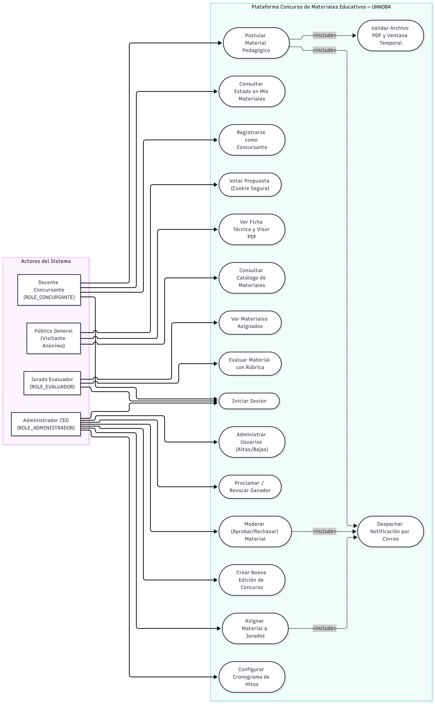

<details>
<summary>📐 Ver especificación en Mermaid.js</summary>

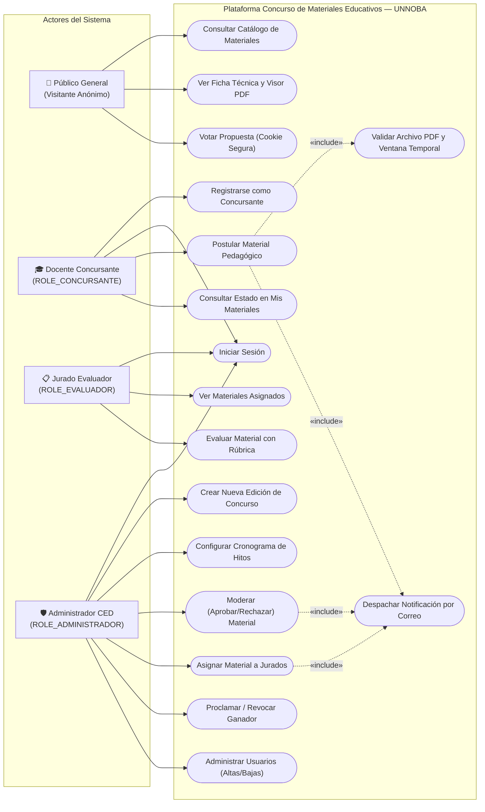
</details>

---

## Diagramas de Secuencia de Funcionalidades Principales

### 1. Secuencia: Creación y Postulación de un Material Educativo

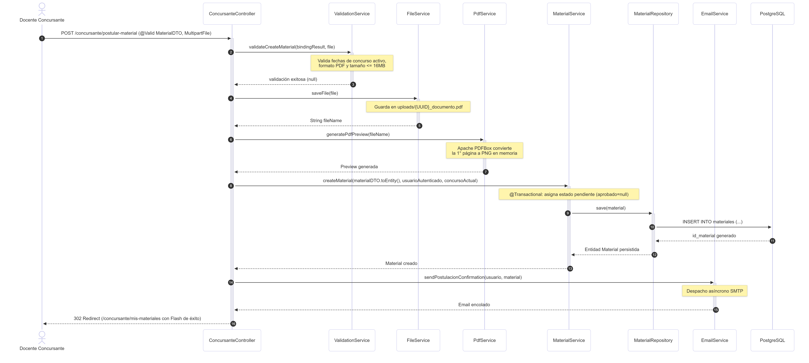

<details>
<summary>📐 Ver especificación en Mermaid.js</summary>

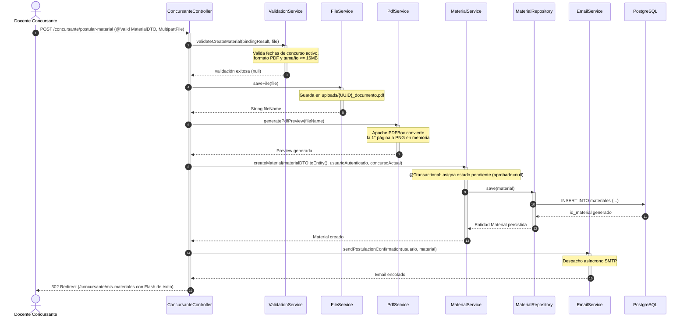
</details>

### 2. Secuencia: Evaluación y Calificación de Material por Jurado

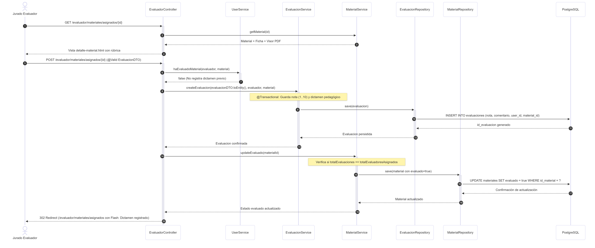

<details>
<summary>📐 Ver especificación en Mermaid.js</summary>

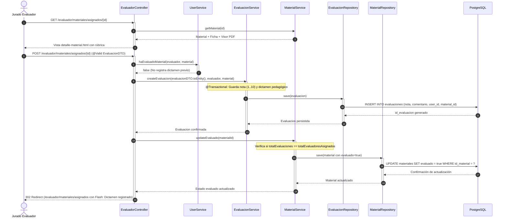
</details>

### 3. Secuencia: Moderación y Asignación de Jurados por Administrador

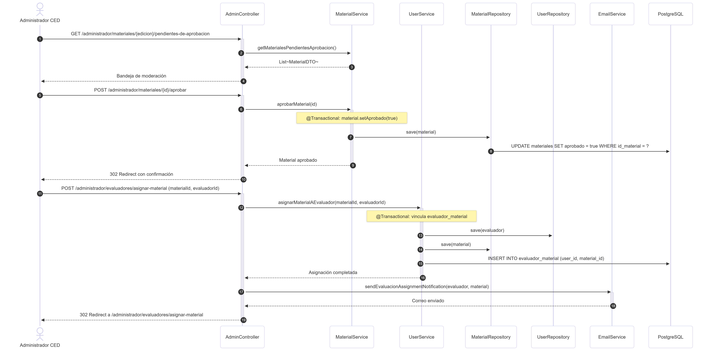

<details>
<summary>📐 Ver especificación en Mermaid.js</summary>

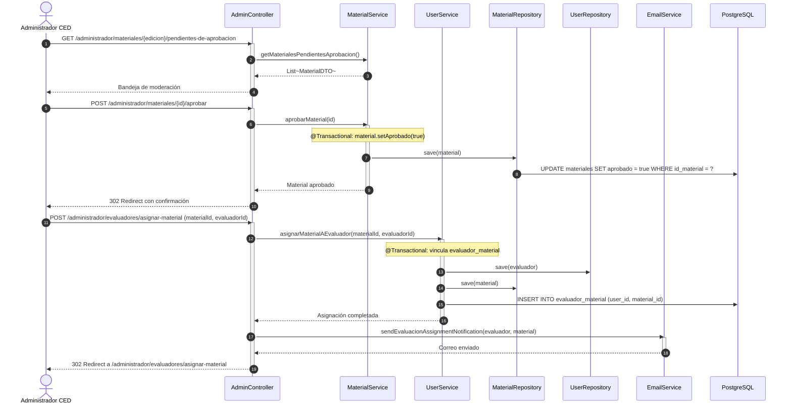
</details>

### 4. Secuencia: Votación Comunitaria Anónima

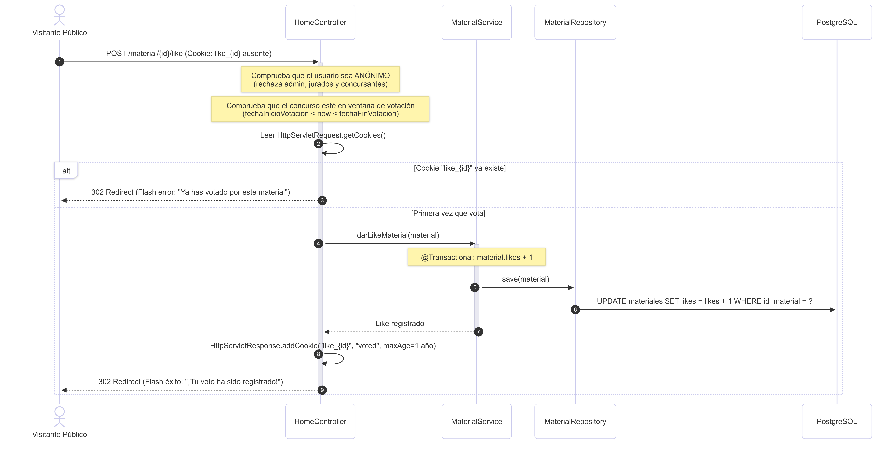

<details>
<summary>📐 Ver especificación en Mermaid.js</summary>

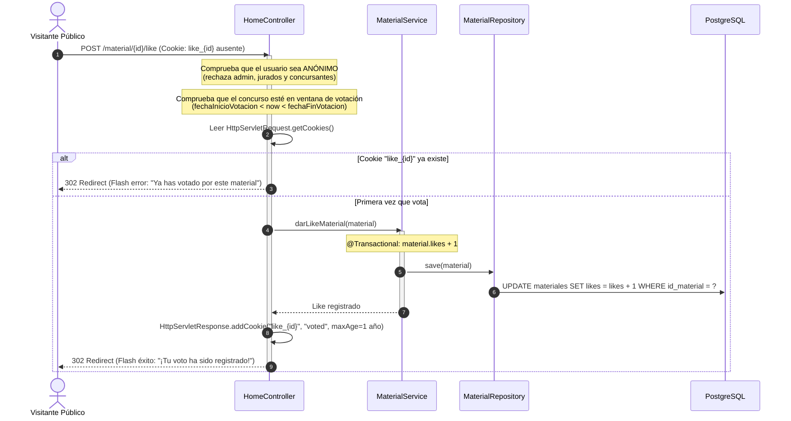
</details>

---

## Stack Tecnológico

| Capa / Componente | Tecnología | Propósito |
|---|---|---|
| **Lenguaje** | **Java 21 (LTS)** | Lenguaje base con sintaxis moderna, tipado estático robusto y excelente soporte de concurrencia. |
| **Framework Backend** | **Spring Boot 3.1.5** | Core del servidor web, inyección de dependencias y configuración declarativa. |
| **Seguridad y Acceso** | **Spring Security 6** | Autenticación basada en sesiones, encriptación BCrypt, tokens CSRF y control RBAC. |
| **Persistencia** | **Spring Data JPA & Hibernate** | Mapeo objeto-relacional (ORM), gestión transaccional y repositorios derivados. |
| **Base de Datos Principal**| **PostgreSQL** | Motor relacional robusto con transaccionalidad ACID para producción. |
| **Base de Datos de Test**  | **H2 Database (In-Memory)** | Base de datos embebida para pruebas unitarias y de integración veloces y aisladas. |
| **Motor de Plantillas** | **Thymeleaf 3.1** | Renderizado del lado del servidor (SSR) acoplado con directivas de seguridad (`extras-springsecurity6`). |
| **Diseño / Estilos** | **Bootstrap 5 & Vanilla CSS** | Maquetación web moderna, responsive, componentes interactivos y alertas. |
| **Procesamiento PDF** | **Apache PDFBox 2.0.31** | Renderizado programático de documentos PDF a imágenes PNG para generación de miniaturas. |
| **Mailing** | **Spring Boot Starter Mail** | Despacho de notificaciones transaccionales vía protocolo SMTP. |
| **Productividad** | **Project Lombok** | Reducción de código repetitivo (Getters, Setters, Constructores, Builders). |
| **Testing** | **JUnit 5, Mockito & MockMvc** | Batería de pruebas de controladores, validaciones de seguridad e integración de endpoints. |
| **Gestor de Construcción**| **Apache Maven** | Gestión integral de dependencias, empaquetado y ciclo de construcción del artefacto. |

---

## Instalación y Puesta en Marcha

### Prerrequisitos
- **Java Development Kit (JDK) 21** o superior instalado y configurado en el `PATH`.
- **PostgreSQL 14+** en ejecución con una base de datos creada (por defecto llamada `ced`).
- **Git** y **Maven** (o utilizar el wrapper incluido `./mvnw` / `mvnw.cmd`).

### 1. Clonar el Repositorio
```bash
git clone https://github.com/tu-usuario/AppWebConcursoMaterialesEducativos.git
cd AppWebConcursoMaterialesEducativos
```

### 2. Configurar la Base de Datos y Variables
La aplicación incluye valores por defecto para desarrollo local en `src/main/resources/application.properties`, personalizables mediante variables de entorno:

| Variable de Entorno | Descripción | Valor por Defecto |
|---|---|---|
| `SPRING_DATASOURCE_URL` | URL de conexión JDBC | `jdbc:postgresql://localhost:5432/ced` |
| `SPRING_DATASOURCE_USERNAME` | Usuario de PostgreSQL | `postgres` |
| `SPRING_DATASOURCE_PASSWORD` | Contraseña de PostgreSQL | *(vacío por defecto)* |
| `SPRING_MAIL_USERNAME` | Correo emisor SMTP | *(vacío)* |
| `SPRING_MAIL_PASSWORD` | Token de aplicación SMTP | *(vacío)* |
| `APP_UPLOAD_DIR` | Directorio de almacenamiento de PDFs | `uploads/` |

### 3. Compilación y Ejecución

**En sistemas Windows (PowerShell / CMD):**
```powershell
.\mvnw.cmd clean spring-boot:run
```

**En sistemas Linux / macOS:**
```bash
./mvnw clean spring-boot:run
```

Una vez iniciado el servidor, acceder en el navegador a:  
**`http://localhost:8080`**

---

## Pruebas Automatizadas y Calidad

El proyecto dispone de un conjunto integral de **pruebas de integración y seguridad** que validan:
- Filtros de acceso según rol y denegación a recursos protegidos.
- Exclusión estricta de usuarios autenticados en el flujo de votación comunitaria anónima.
- Ciclo completo de evaluación y moderación de materiales.
- Manejo correcto de excepciones y redirecciones contextuales con mensajes flash.

Para ejecutar la suite completa de pruebas:
```bash
.\mvnw.cmd test
```

---

## Créditos y Reconocimientos

- **Institución:** Universidad Nacional del Noroeste de la Provincia de Buenos Aires (**UNNOBA**).
- **Destinatario del Sistema:** Área de **Educación Digital (CED)**.
- **Desarrollo:** Proyecto académico realizado en equipo para la acreditación articulada de tres asignaturas de la carrera (*Programación Orientada a Objetos*, *Análisis y Diseño de Sistemas 2* y *Práctica Profesional y Legislación*).
